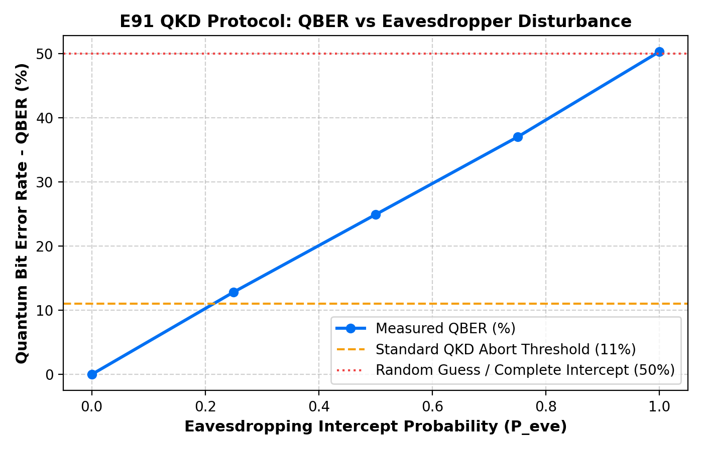
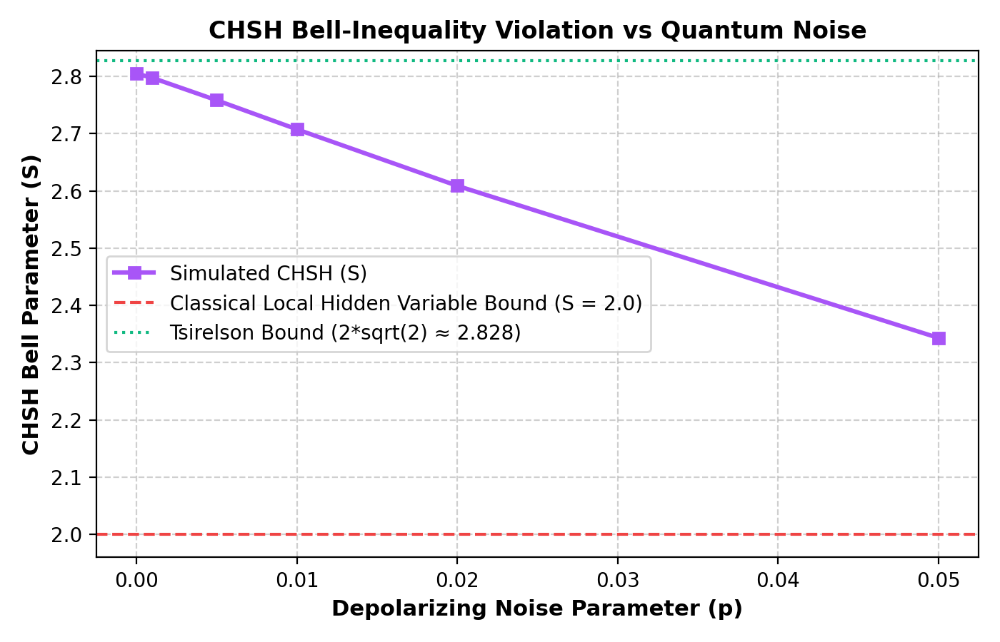
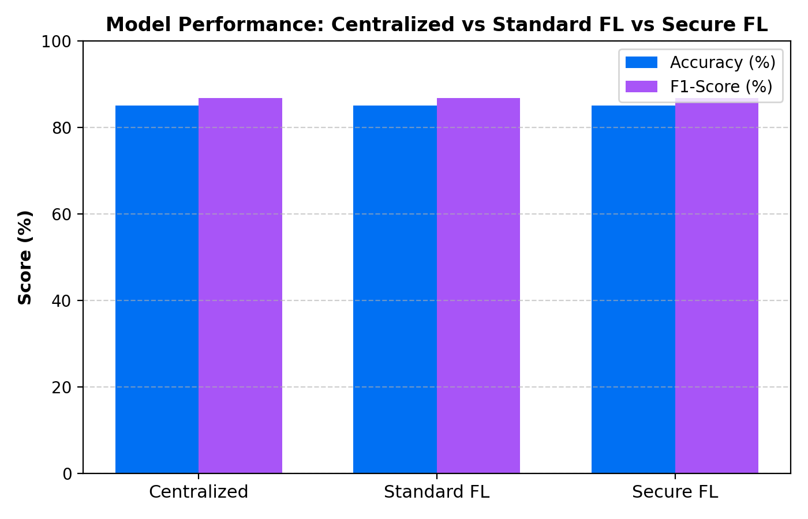
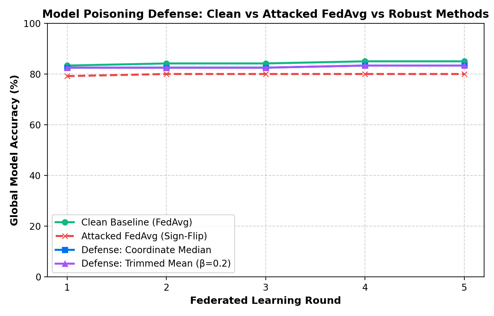

# Quantum-Secured Federated Learning for IoT Networks with Byzantine-Robust Aggregation

A research prototype integrating **E91 Quantum Key Distribution (QKD)**, cryptographic communication, Federated Learning (FL), and Byzantine-robust aggregation to explore secure and privacy-preserving machine learning in distributed IoT networks.

## Overview

Federated Learning enables multiple distributed devices to collaboratively train a machine learning model without sharing their raw local datasets. However, model updates transmitted between clients and servers can be exposed to security threats, replay attacks, and malicious model-poisoning attempts.

This project explores a multi-layer security architecture combining quantum key distribution simulation, cryptographic protection, and robust federated aggregation.

The system uses the **Ekert 1991 (E91) protocol** to simulate quantum key establishment, AES-256-GCM and HMAC-SHA256 to protect model-update communication, and Byzantine-robust aggregation algorithms to mitigate malicious client updates.

An interactive web dashboard provides access to the quantum simulations, federated learning experiments, security demonstrations, and evaluation results.

## Key Features

- **E91 Quantum Key Distribution:** Entanglement-based QKD simulation using the singlet state.
- **CHSH Bell Inequality:** Quantum correlation analysis and Bell inequality verification.
- **Eavesdropping Simulation:** Intercept-resend attack experiments with Quantum Bit Error Rate (QBER) analysis.
- **Quantum Noise Simulation:** Depolarizing noise experiments and their impact on CHSH correlations.
- **Secure Communication:** AES-256-GCM authenticated encryption and HMAC-SHA256 message authentication.
- **Replay Attack Protection:** Message ID, client session, and communication-round tracking.
- **Federated Learning:** Multi-client distributed training using local logistic regression and Federated Averaging (FedAvg).
- **IID and Non-IID Data:** Experiments with different client data distributions.
- **Byzantine-Robust Aggregation:** Coordinate-wise Median and Trimmed Mean to mitigate model-poisoning attacks.
- **Attack Simulation:** Sign-flip, Gaussian perturbation, and constant-bias attacks.
- **IoT Communication:** Optional MQTT transport adapters.
- **Interactive Dashboard:** Seven sections covering architecture, quantum simulation, federated learning, threats, cryptography, benchmarks, and robust aggregation.

## System Architecture

```text
       IoT Clients (5 Simulated Nodes)
                    |
                    v
          Local Model Training
                    |
                    v
          Model Parameter Updates
                    |
                    v
         E91 Quantum Key Distribution
             (QKD Simulation)
                    |
                    v
          SHA-256 Session Key Derivation
                    |
                    v
        AES-256-GCM + HMAC-SHA256
                    |
                    v
          Replay Protection & Verification
                    |
                    v
           Federated Learning Server
                    |
          +---------+----------+
          |         |          |
          v         v          v
        FedAvg   Coordinate   Trimmed
                  Median       Mean
          |         |          |
          +---------+----------+
                    |
                    v
             Global Model Update
                    |
                    v
          Evaluation & Dashboard
```

## Technologies Used

| Category | Technologies |
|---|---|
| Programming Language | Python |
| Quantum Simulation | Qiskit, Qiskit Aer |
| Machine Learning | Scikit-learn |
| Numerical Processing | NumPy, Pandas |
| Cryptography | AES-256-GCM, HMAC-SHA256, SHA-256 |
| Backend | Flask, Flask-CORS |
| Frontend | HTML, CSS, JavaScript |
| IoT Communication | MQTT, Paho-MQTT |
| Visualization | Matplotlib |
| Testing | Pytest |

## Project Structure

```text
quantum_project_1/
│
├── README.md
├── start.bat
├── package.json
│
├── backend/
│   ├── quantum/
│   │   ├── e91.py
│   │   ├── noise.py
│   │   └── attacks.py
│   │
│   ├── crypto/
│   │   ├── key_manager.py
│   │   ├── aes_crypto.py
│   │   ├── hmac_auth.py
│   │   └── replay_detector.py
│   │
│   ├── federated/
│   │   ├── dataset.py
│   │   ├── model.py
│   │   ├── client.py
│   │   ├── fedavg.py
│   │   ├── server.py
│   │   └── robust_aggregation.py
│   │
│   ├── mqtt/
│   ├── experiments/
│   ├── tests/
│   ├── results/
│   ├── docs/
│   └── requirements.txt
│
├── frontend/
│   ├── index.html
│   ├── style.css
│   └── app.js
│
└── server/
    └── api_server.py
```

## Experimental Results

The following are results recorded in the project's experimental documentation. They represent the supplied simulation runs, rather than guaranteed results on every execution.

### 1. Federated Learning Performance

| Model | Accuracy | Precision | Recall | F1-score |
|---|---:|---:|---:|---:|
| Centralized Learning | 85.0% | 0.766 | 1.000 | 0.868 |
| Standard FedAvg | 85.0% | 0.766 | 1.000 | 0.868 |
| Quantum-Secured FL | 85.0% | 0.766 | 1.000 | 0.868 |

### 2. Eavesdropping Detection

The E91 simulation evaluates how intercept-resend eavesdropping affects the Quantum Bit Error Rate.

| Eve Interception Probability | QBER |
|---:|---:|
| 0% | 0.00% |
| 25% | 12.84% |
| 50% | 24.93% |
| 75% | 37.02% |
| 100% | 50.34% |

### 3. CHSH Bell Inequality Under Noise

| Noise Probability | CHSH Score |
|---:|---:|
| 0.000 | 2.805 |
| 0.001 | 2.798 |
| 0.005 | 2.758 |
| 0.010 | 2.708 |
| 0.020 | 2.609 |
| 0.050 | 2.343 |

The simulated CHSH values remain above the classical local-hidden-variable bound of 2 for the tested noise levels.

### 4. Byzantine-Robust Aggregation

The project evaluates aggregation algorithms under simulated sign-flip model-poisoning attacks.

| Scenario | Aggregation | Accuracy |
|---|---|---:|
| Clean (0 malicious clients) | FedAvg | 85.0% |
| 1 malicious client | FedAvg | 80.0% |
| 1 malicious client | Coordinate Median | 83.3% |
| 1 malicious client | Trimmed Mean | 83.3% |
| 2 malicious clients | FedAvg | 22.5% |
| 2 malicious clients | Trimmed Mean | 22.5% |
| 2 malicious clients | Coordinate Median | 83.3% |

These experiments illustrate the potential benefits and limitations of robust aggregation when federated clients submit malicious updates.

## Research Visualizations

The repository includes experimental plots and saved results.

### Eavesdropping and QBER



### CHSH versus Quantum Noise



### Federated Learning Convergence



### Byzantine-Robust Aggregation



## Installation and Execution

### Prerequisites

- Python 3.11 or later (the project documentation recommends Python 3.11–3.13).
- pip
- Git
- A modern web browser

### 1. Clone the repository

```bash
git clone https://github.com/YOUR-USERNAME/quantum-secure-federated-learning.git

cd quantum-secure-federated-learning
```

### 2. Create a virtual environment

```bash
python -m venv .venv
```

Activate it on Windows:

```powershell
.venv\Scripts\activate
```

### 3. Install dependencies

```bash
python -m pip install -r backend/requirements.txt
```

### 4. Start the application

On Windows:

```powershell
.\start.bat
```

Alternatively, run the Flask server directly from the project root:

```bash
python server/api_server.py
```

Open the dashboard:

http://127.0.0.1:5000

### 5. Run automated tests

```bash
cd backend
python -m pytest tests -v
```

### 6. Run experiments

From the backend directory:

```bash
python -m experiments.run_all
```

To regenerate research figures:

```bash
python -m experiments.plot_results
```

## Documentation

Additional technical documentation is available in `backend/docs/`:

- `ARCHITECTURE.md` – System architecture and component descriptions.
- `THREAT_MODEL.md` – Security assumptions and threat model.
- `EXPERIMENTS.md` – Experimental setup and execution.
- `RESULTS_AND_ANALYSIS.md` – Experimental findings and analysis.
- `LIMITATIONS.md` – Scientific scope and implementation limitations.

Additional implementation details are available in:

- `backend/IMPLEMENTATION_AND_VALIDATION.md`
- `backend/ROBUST_AGGREGATION_EXTENSION.md`
- `backend/VALIDATION_RUN.md`

## Limitations and Scope

This project is a **software-based research prototype**, not a production-ready quantum communication system.

- E91 QKD is simulated using software; no physical quantum hardware is used.
- SHA-256 session-key derivation is a prototype placeholder and does not implement a complete production QKD post-processing pipeline.
- CHSH violation alone does not establish complete QKD security.
- AES-GCM and HMAC protect communication but cannot guarantee that participating clients train honestly.
- Coordinate Median and Trimmed Mean mitigate certain poisoning attacks but are not universal defenses against targeted backdoor attacks.
- MQTT deployment with a real broker and production TLS authentication has not been validated.

## Research Reference

The backend documentation identifies the following research paper as its reference:

*Integrating quantum computing with federated learning for enhanced security and privacy in IoT networks.*

**Journal:** Results in Engineering, Elsevier  
**DOI:** https://doi.org/10.1016/j.rineng.2025.108500

## Future Work

- More rigorous QKD post-processing and finite-key security analysis.
- Evaluation using real-world IoT datasets.
- More extensive non-IID federated learning experiments.
- Advanced model-poisoning and backdoor attack evaluation.
- Real MQTT broker integration with TLS authentication.
- Validation on quantum computing hardware.
- Repeated experiments across multiple random seeds.

## Acknowledgements

This repository is intended for academic and research exploration at the intersection of quantum computing, cybersecurity, IoT, and distributed machine learning.

---

**Disclaimer:** Experimental results are specific to the documented simulation configurations and should be independently reproduced before being treated as general performance or security guarantees.